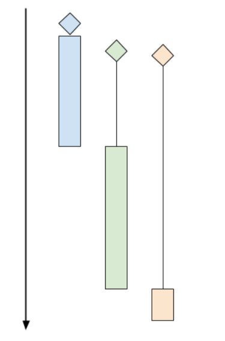
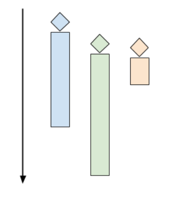
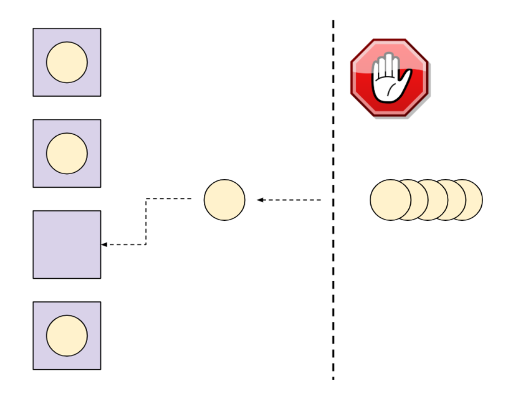

The protocol is stateful. the server changes internal state based on data client send.

1. wait for client.
2. Client connected (Input), send request (its output).
3. Server waits for client message.
4. Server receives message (client input: receives char x [x != $]).
5. Server response output to client (char x+1).
6. the server ignores everything the client sends until it see a ^ character that signals that a new message begins.
7. When the client send a $, the server goes back to waiting for a new message.

=> The ^ and $ characters are only used to delimit messages.

# Multi-thread

The performance of the sequential server (accept one request not more) is consume a lot of compute
resources and waste it, while the server processes a client connection.

=> The clients spent waiting of the server to actually accept their connection.

In multi-threaded server launch multiple control threads, letting the OS manage concurrency on the CPU across multiple CPU cores.
When a client connects, a thread is created to serve it.

**Thread pools**

The server creates a number of working threads that expect to get tasks from some queue. The is the pool.
Each client connection is dispatched as a task to the pool.
If all threads in the pool are ccurrently busy, the server blocks until pool accepts the task (thread finished processing its currenr task.)

